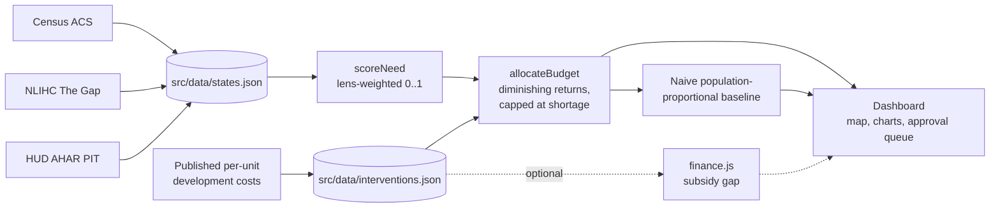

# Lepus Solutions

**Where should the next affordable home be built, and how?** Lepus Solutions helps state and federal decision makers spend a fixed budget on housing for extremely-low-income (ELI) households where it closes the most need per dollar. It uses only real, cited public data.

**Live demo:** https://ahasenbein.github.io/lepus-solutions/

## The problem

- The U.S. has a shortage of **7.2 million** rental homes that are affordable and available to renters with extremely low incomes. ([NLIHC, *The Gap*, 2026](https://nlihc.org/gap))
- Only **35** affordable and available rental homes exist for every **100** extremely-low-income renter households. ([NLIHC, *The Gap*, 2026](https://nlihc.org/gap))
- **745,652** people were homeless on a single night in January 2025, and **266,320** of them were unsheltered. ([HUD, 2025 AHAR Part 1, released May 29, 2026](https://www.hud.gov/news/hud-no-26-037))

Budgets are finite and need is uneven. A dollar buys a different number of homes in different places, depending on the intervention: new construction, acquisition-rehab, modular, or hotel/motel conversion. Spending is often split by population or by precedent. Lepus Solutions makes the trade-offs explicit and shows how each recommendation was reached.

## Features

- **National need map.** A state choropleth of ELI shortage, homelessness, and rent burden, with a detail panel for each state.
- **Budget optimizer.** Enter a budget and choose the interventions. The engine allocates dollars across states and intervention types, with diminishing returns capped at each state's shortage.
- **Stakeholder lenses.** *Planner*, *Budget Office*, and *Community Advocate* weight need differently. This follows the role-based portal pattern (owner/worker/tenant) of the Lepus product family.
- **Approve/reject queue.** Review each recommended allocation before it goes into a plan.
- **Baseline comparison.** See how much more the optimized plan achieves than a naive population-proportional split.
- **Citations everywhere.** Every number links back to its source. Missing data stays `null` and is never estimated.

## Lineage: built on Lepus Analytics

Lepus Solutions is the public-sector sibling of [Lepus Analytics](https://github.com/AHasenbein/lepus-analytics), a real-estate analytics product. The plan is to port Lepus Analytics' analytical system into this project's engine:

- **Underwriting deal math** (NPV and IRR), used for an optional subsidy-gap calculation (`src/engine/finance.js`)
- **Gradient-boosted valuation** and **nearest-neighbor comps**
- **HUD Small Area Fair Market Rent baselines** for rents
- **Live slider re-screening**, so results update as you change a budget or a weight

The UI also uses the Lepus Analytics design language: dark zinc neutrals with indigo accents.

## How it works



Read the plain-language version in [docs/METHODOLOGY.md](docs/METHODOLOGY.md). The engine specification is in [docs/ENGINE.md](docs/ENGINE.md), and every source and vintage is listed in [docs/DATA_SOURCES.md](docs/DATA_SOURCES.md).

## Quick start

Requires Node 22.

```bash
npm ci                 # install exact dependencies
npm run dev            # start the local dev server (Vite)
npm run build          # build the production bundle into dist/
npm run lint           # run ESLint
node --test src/engine/  # run the engine unit tests (Node built-in test runner)
npm run fetch:census   # refresh the ACS fields from the Census API
```

## Project structure

```
src/
  data/          states.json, interventions.json (cited public data only)
  engine/        allocate.js: pure scoring and optimizer functions; finance.js (optional subsidy gap); *.test.mjs
  components/    USMap.jsx (d3-geo), ui.jsx (Lepus Analytics design kit), dashboard views
  App.jsx        app shell and stakeholder lenses
scripts/         data fetchers (e.g. fetch-census.mjs)
docs/            METHODOLOGY.md, DATA_SOURCES.md, ENGINE.md
.github/         CI, GitHub Pages deploy, issue and PR templates
```

- [CONTRACTS.md](CONTRACTS.md): module interfaces shared across workstreams
- [docs/METHODOLOGY.md](docs/METHODOLOGY.md): how need and allocation work, in plain language
- [docs/DATA_SOURCES.md](docs/DATA_SOURCES.md): every dataset, its vintage, and the fields it feeds
- [docs/ENGINE.md](docs/ENGINE.md): the engine algorithm and API
- [ROADMAP.md](ROADMAP.md): planned work and the datasets it would use
- [CONTRIBUTING.md](CONTRIBUTING.md): how to add data sources, interventions, and lenses

**Stack:** Vite 7, React 19, Tailwind CSS v4, d3-geo, Recharts.

## Limitations and ethics

- **Decision support, not a decision maker.** The output is a starting point for deliberation. Local knowledge, community input, fair housing obligations, and legal constraints have to shape any real allocation.
- **State-level granularity.** State averages hide large differences between cities, counties, and neighborhoods. A state ranked "lower need" can still contain areas of acute need.
- **Data vintages differ.** ACS, NLIHC, and HUD PIT figures come from different years, and the exact vintages are in [docs/DATA_SOURCES.md](docs/DATA_SOURCES.md). Point-in-Time counts are a single-night snapshot and are widely understood to undercount homelessness.
- **Cost figures are approximate.** Per-unit costs are published national figures. They are adjusted by region only where a sourced cost index exists.
- **No invented numbers.** If a value is not available from a cited source, it is `null`, and the UI says so.

## License

[MIT](LICENSE) © 2026 Alex Hasenbein

---

<sub>Powered by **Lepus Analytics**</sub>
